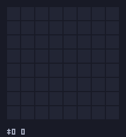

# blockblast-bench

[](https://github.com/kittimzhe/blockblast-bench/actions/workflows/tests.yml)


**Block Blast 游戏环境 + AI Agent 评测系统**：复刻 Block Blast!（8x8 方块消除）的游戏机制，让大模型 / 启发式 Agent 对局打分，量化评测模型的**空间规划、长程决策与指令遵循**能力。

> **English**: A deterministic Block Blast (8x8 block puzzle) environment and LLM-agent benchmark, in pure stdlib Python. Agents — `random` / `greedy` / `heuristic` baselines and any OpenAI-compatible LLM — play identical seeded games; the harness scores spatial planning, long-horizon survival and instruction following, renders episodes as animated GIFs, and also ships as an [inspect_ai](https://inspect.aisi.org.uk/) Task.

纯 Python 标准库实现（零第三方依赖），完全确定性（同种子 = 同牌序），所有 Agent 在相同种子集上对比，结果公平可复现。

## 快速开始

```bash
git clone https://github.com/kittimzhe/blockblast-bench.git
cd blockblast-bench

# 看一局演示（启发式 Agent 实时走子）
python3 -m blockblast demo --agent heuristic --seed 42

# 跑经典基线（random / greedy / heuristic 各 10 局）
bash examples/run_baselines.sh

# 评测一个 LLM（任何 OpenAI 兼容端点）
DEEPSEEK_API_KEY=sk-... python3 -m blockblast run --agent llm \
    --base-url https://api.deepseek.com --model deepseek-chat \
    --api-key-env DEEPSEEK_API_KEY --episodes 5 --save-dialog

# 查看排行榜 / 回放某一局
python3 -m blockblast leaderboard
python3 -m blockblast replay results/<run_id>/episodes/seed_2024.json

# 把某一局导出成 GIF 动图 / 在终端里动画播放
python3 -m blockblast gif   results/<run_id>/episodes/seed_2024.json --speed 1.5
python3 -m blockblast watch results/<run_id>/episodes/seed_2024.json --delay 0.15
```

> macOS 系统 Python 对字节码缓存目录有权限限制时，在命令前加 `PYTHONDONTWRITEBYTECODE=1`。
> 测试：`python3 -m pytest`（99 个用例，Python 3.9+；GIF 像素级校验需额外装 pillow）。

## 测试策略

CI 在 Python 3.9 与 3.13 上跑全部用例，按四层组织：

| 层 | 文件 | 测什么 |
|---|---|---|
| 单元 | `test_pieces/scoring/env/render` | 方块库、计分公式、放置/消除规则、文本渲染 |
| **不变量随机对测** | `test_invariants.py` | 数百局随机对局逐步断言：格子数守恒、消除行列必空、combo/分数账目可复算、托盘生命周期、game over ⇔ 无合法步；**敌意输入模糊测试**（越界/错误类型/用过的槽/畸形动作 → 只会抛 `InvalidActionError` 且状态零污染）；**golden 测试**钉死固定种子的最终结果——引擎语义一旦改变立即报警 |
| 回归带 | `test_regression_bands.py` | 基线分数区间 + 能力阶梯（random < greedy < heuristic）必须成立 |
| 端到端 | `test_cli_smoke.py`、`test_agents/harness/resume/analysis/animate` | 8 个 CLI 子命令全覆盖、产物文件、断点续跑、网络故障注入（超时/429/5xx/200 空 body）、GIF 像素级解码校验 |

内置自校验：greedy 基线的决策效率恒等于 1.000（它就是单步最优的定义），任何偏离都是分析器或引擎的 bug。

## 动图回放

每局评测的完整转录都可以渲染成动画，便于直观分析 Agent 的走子风格：

| GIF | Agent | 单局成绩 |
|---|---|---|
|  | heuristic | 1142 分（seed 2027） |
|  | qwen3.7-plus（LLM） | 862 分（seed 2025，87 步 / 37 行 / combo 7） |

- `blockblast gif <episode.json>` — 导出 GIF 动图：琥珀色 = 新落子，白色闪烁 = 消除行列，底部 HUD 显示步数/得分/combo。**纯标准库实现**（内置 GIF89a + LZW 编码器，`gifenc.py` 约 150 行），不引入任何图像依赖；编码正确性在测试中用 Pillow 做像素级解码校验。
- `blockblast watch <episode.json>` — 终端内 ANSI 动画回放，适合快速翻看。

## 基线参考成绩（默认种子 2024..2033，10 局）

| # | Agent | Mean | Median | Max | Moves | Lines | Combo |
|---:|---|---:|---:|---:|---:|---:|---:|
| 1 | heuristic | 586.9 | 513.0 | 1142 | 64.0 | 26.9 | 4 |
| 2 | greedy | 169.3 | 151.5 | 358 | 24.7 | 6.7 | 4 |
| 3 | random | 56.9 | 55.5 | 94 | 13.3 | 0.9 | 1 |

被测 LLM 的成绩落在这个梯度的哪个位置，直观反映其空间规划能力：**不如 random = 连合法放置都难以维持；超过 greedy = 具备一步收益规划；逼近 heuristic = 有板面形状管理意识**。

**LLM 实测**（qwen3.7-plus，同种子集 10 局，2026-10-26）：mean 286.9 / median 246 / **max 862**（87 步、37 行、combo 7，单局超过 heuristic 均值），mean_moves 32.1，best_combo 7，invalid_per_move 0.0125——**已超过 greedy 基线，位居排行榜第 2**。决策分析：单步效率 0.954、消行机会把握 125/130 = 96%。其中 6 局被端点网络故障（读超时 / TLS 连接被掐断）截断，`--resume` 可从断点续跑补完；被截断的局也计入部分分数。

## 游戏规则（忠实复刻）

- 8x8 棋盘；托盘一次发 3 块，**全部用完才补发**；方块**不可旋转/翻转**。
- 整行或整列填满即消除（可同时多行列）；连续消除累计 combo；无子可放则游戏结束。
- 方块库 19 种（与 1010!/Block Blast 一致）：1x1、横竖 2~5 直线、2x2、3x3、小 L（3 格 x4 方向）、大 L（5 格 x4 方向）。`python3 -m blockblast shapes` 可查看全部。

### 计分模型（文档化近似）

官方计分常数未公开，本项目机制忠实、常数透明（`ScoringConfig` 可配置）：

- 落子：每格 +1。
- 消行：递进计分，1 行=10、2 行=30、3 行=60…
- combo：连续消除第 n 次，消行分 ×(1 + 0.5×(n-1))，上限 ×4。
- 全清（Perfect Clear）：额外 +300。

> 所有 Agent 在同一规则下对比，常数的绝对值不影响排名的公平性。

## 架构

```
blockblast/
├── pieces.py      # 19 种方块形状库（规范化、去重、确定性顺序）
├── env.py         # 游戏环境：放置/消除/combo/计分 + 纯函数模拟接口
├── scoring.py     # 计分模型（全部常数集中于 ScoringConfig）
├── render.py      # 文本渲染：带坐标棋盘 + 托盘 mini-grid（LLM 可解析）
├── gifenc.py      # 纯标准库 GIF89a/LZW 动图编码器
├── animate.py     # 转录 -> 逐帧动画（落子高亮/消除闪烁/HUD）
├── agents/
│   ├── base.py            # Agent 抽象：act(obs, feedback) -> Action
│   ├── random_agent.py    # 随机合法步（下界基线）
│   ├── greedy_agent.py    # 单步收益最大化
│   ├── heuristic_agent.py # 收益 + 贴边/碎片化/死区/平整度 特征
│   └── llm_agent.py       # OpenAI 兼容端点（urllib 实现，零依赖）
├── harness.py     # 评测循环：固定种子集、非法步反馈重试、指标聚合
├── analysis.py    # 决策质量分析：贪心效率/漏消行/终局碎片化/非法步分类
├── report.py      # summary.json / 逐局转录 / runs.jsonl / leaderboard.md
└── cli.py         # demo / run / leaderboard / replay / gif / watch / analyze / shapes
```

### 评测协议

- **公平性**：所有 Agent 使用同一种子集（`--seed-base` + 局数递增），面对完全相同的发牌序列。
- **非法步策略**：LLM 输出不合法（越界/重叠/格式错误）时，错误信息作为 feedback 回喂重试，默认每步最多 2 次；仍失败则该局终止（保留已得分数），计入 `invalid_per_move` 与 `valid_completion_rate` —— 格式遵循能力成为显式指标而非隐性噪声。
- **确定性**：环境发牌用 `random.Random(seed)`；LLM 默认 `temperature=0`。
- **网络韧性**：每步最多 `--network-retries`（默认 6）次请求，指数退避（2s→4s→…上限 60s），429/5xx 视为瞬态自动重试；读超时后下一次尝试的超时预算自动翻倍（上限 600s），适配慢推理模型与不稳定端点。
- **断点续跑**：局以 `agent_error` 中断时已走的步数持久化在转录里；`blockblast run --resume <run_dir> ...` 会保留已完成的局、把中断的局**从中断那一步精确恢复**（环境确定性保证重放后状态一致），token 统计跨段累加。

### 指标

| 指标 | 含义 |
|---|---|
| `mean/median/max_score` | 得分（核心能力指标） |
| `mean_moves` | 平均存活步数（长程规划） |
| `mean_lines` / `best_combo` | 消行效率与连击规划 |
| `invalid_per_move` | 每步非法输出率（指令遵循） |
| `valid_completion_rate` | 正常终局比例（非因非法步/接口错误中断） |
| `tokens_per_move` | 每步 token 开销（效率） |

### 决策质量分析（`blockblast analyze <run_dir>`）

对已完成的 run 做离线深度分析——环境确定性使每一步局面都可以精确重放，再与单步最优对照：

| 指标 | 含义 |
|---|---|
| `greedy_efficiency` | 实际得分 / 单步最优得分（greedy 基线恒为 1.000，天然校验） |
| `clear_conversion` / `missed_clears` | 有消行机会时抓住了多少次 / 错过多少次 |
| `final_fill` / `final_empty_regions` | 终局填充率与空格碎片化程度（死因画像） |
| `invalid_kinds` | 非法步归类：越界/重叠、用过的槽位、解析失败…… |

实测示例：qwen3.7-plus 的 `greedy_efficiency=0.974`、消行机会 13/13 全中——它的单步决策接近最优，低分主要来自对局被平台中断；而 heuristic 效率 0.979 却能活 64 步，说明**差距在布局质量（终局碎片化 1.7 vs 7.7 个空区）而非单步贪心**。

## 接入任意 LLM

任何 `POST {base_url}/chat/completions` 的 OpenAI 兼容端点都可直接评测：

```bash
# DeepSeek / OpenAI / GLM / 本地 vLLM 预设见 examples/run_llm.sh
python3 -m blockblast run --agent llm \
  --base-url https://api.deepseek.com --model deepseek-chat \
  --api-key-env DEEPSEEK_API_KEY \
  --episodes 5 --concurrency 2 --save-dialog --tag v1
```

- `--save-dialog`：保存每步完整 prompt/回复到逐局 JSON，便于失败分析。
- `--system-prompt-file`：替换默认系统提示词，可做 prompt 变体对比实验。
- `--concurrency N`：多局并行（注意端点限流）。
- `--timeout` / `--network-retries`：慢推理模型建议 `--timeout 180`；端点不稳时重试会自动指数退避并放大超时。
- `--resume <run_dir>`：续跑一次被网络中断的 run（保留完成局、从断点恢复未完成局，产出一个新的完整 run）。
- `--allow-reasoning`：prompt 变体——允许模型先自由分析局面、最后一行给 JSON（解析器取**最后一个**合法 JSON，推理中提到的候选不会被误读）。与默认"只回 JSON"模式同种子对比，可量化推理空间对空间规划的增益。

模型看到的观测是带坐标的文本棋盘 + 托盘 mini-grid，要求只回复
`{"piece": 0-2, "row": 0-7, "col": 0-7}`。测试套件里有一个"假端点"
通过解析该文本自动走子，保证了观测格式对机器可解析。

## 以 inspect_ai Task 运行

`blockblast/inspect_task.py` 把 benchmark 适配为 [inspect_ai](https://inspect.aisi.org.uk/) Task（每个 Sample 一局，自定义 solver 驱动游戏循环），可复用 inspect 的模型接入、并发、重试与日志查看器：

```bash
# 冒烟（无网络）；或任何 inspect 支持的模型
./examples/run_inspect.sh mockllm/model -T episodes=2
MASS_API_KEY=... ./examples/run_inspect.sh openai-api/mass/qwen3.7-plus -T episodes=10

# 查看结果
uv run --no-project --with inspect-ai --python 3.13 -- inspect view --log-dir ./inspect-logs
```

- 两个 scorer：`game_score`（最终得分，mean±stderr）与 `finished_cleanly`（正常终局比例）；逐局细节（moves/lines/combo/invalid/reason）存在 Score metadata。
- 需要 Python 3.10+ 与 `inspect-ai`/`openai`（脚本用 `uv` 临时环境自动解决）；核心 benchmark 本体仍保持 3.9 兼容、零依赖。
- 原生 harness（`blockblast run`）与 inspect Task 使用同一套 env/prompt/解析逻辑，结果可互相印证；GIF/排行榜等产物目前由原生 harness 生成。

## 结果产物

```
results/
├── runs.jsonl                  # 每次 run 一行（排行榜索引）
├── leaderboard.md              # 自动刷新的 Markdown 排行榜
└── <run_id>/
    ├── summary.json            # run 元数据 + 聚合指标 + 逐局摘要
    └── episodes/seed_N.json    # 逐局完整转录（+ LLM 对话，若开启）
```

## 设计取舍与局限

- **发牌分布**：真实游戏的生成器为专有且疑似自适应（"pity"机制），本项目默认均匀采样 19 种方块，保证可复现与公平；`BlockBlastEnv(piece_weights=...)` 可自定义权重。
- **计分常数**为近似值（机制忠实），排行榜只在同规则同种子集内可比。
- **颜色不建模**：消除只取决于占格，与颜色无关，故棋盘用布尔格。
- 本项目与 Block Blast! 官方（Hungry Studio）无关，是出于研究目的的机制复刻。

## 贡献

欢迎 PR / Issue，方向举例：

- 更强的基线（beam search / MCTS 多步前瞻，给排行榜一个接近上限的锚点）
- prompt 变体套件（允许推理再出手、不同棋盘表示法的对比实验）
- 更多模型的评测结果（附 `results/<run_id>/` 产物以便复核）
- HTML 报告、自适应发牌模式、best-of-N 采样

提交前请确保 `python -m pytest` 在 Python 3.9 与 3.13 下通过（CI 会跑两个版本）。核心库请保持零第三方依赖。

## License

MIT
